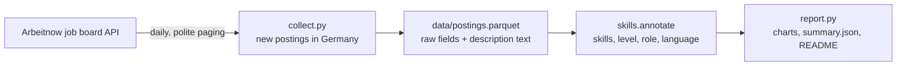

# Job Market Skill Tracker


Which skills do employers in Germany ask for, and does that change over time? A daily pipeline collects job postings, extracts the skills, seniority and language requirements from each one, and keeps a growing history. The results below are regenerated automatically after every run.

## Results

<!-- RESULTS:START -->
*1,031 postings in Germany, published 2026-11-03 to 2026-11-08. Updated automatically.*


- **158 postings** are for working students, interns, thesis students or juniors.
- **42% of postings are written in English**, and 14% of those still ask for fluent German (vs 40% of German-language postings).

| Role family | Postings | Fluent German asked | Written in English | Most mentioned skills |
|---|---:|---:|---:|---|
| software engineering | 185 | 17% | 71% | Python (29%), CI/CD (26%), TypeScript (23%), SQL (22%), LLM / GenAI (18%) |
| sales & marketing | 139 | 34% | 29% | Excel (9%), LLM / GenAI (7%), SAP (5%), AWS (4%), MS Office (4%) |
| ML & AI | 56 | 16% | 57% | LLM / GenAI (54%), Python (38%), Machine learning (29%), PyTorch (14%), SQL (12%) |
| data & analytics | 48 | 40% | 46% | SQL (38%), Python (31%), SAP (19%), Snowflake (15%), Power BI (12%) |
| product & project management | 37 | 32% | 43% | MS Office (16%), Excel (8%), Agile / Scrum (8%), Jira (8%), Machine learning (5%) |

Role families with fewer than 25 postings are left out of the table.
<!-- RESULTS:END -->

## How it works



1. **Collect.** [`collect.py`](collect.py) reads the latest postings from the [Arbeitnow API](https://www.arbeitnow.com/blog/job-board-api), a free, public job board API covering Europe.
   - It reads ten pages at most, spaced six seconds apart, and waits when the API answers "too many requests".
   - It keeps postings located in Germany and skips the ones already stored.
   - Each posting is stored with the date it was first seen, so the file becomes a history.
2. **Store raw, derive later.** The cleaned description text is stored, and skills are not. Skills, seniority level, role family and posting language are recomputed from the text on every report. When a rule is improved, it applies to the whole history, not just to new postings.
3. **Extract.** [`skills.py`](skills.py) uses about 50 skill patterns (programming, data and BI tools, ML and GenAI, cloud, ways of working, language requirements) plus rules for seniority and role family. They are rules, not a model, so every match can be explained and is covered by tests.
4. **Report.** [`report.py`](report.py) writes the charts, [`results/summary.json`](results/summary.json) and the results section of this README. A weekly trend chart appears once four weeks of data have been collected.
5. **Schedule.** A [GitHub Actions workflow](.github/workflows/collect.yml) runs every morning: it collects, reports, and commits the new data.

### A bug worth mentioning

The first version found "ETL" in 23 % of all postings, including sales roles. The reason: each pattern was wrapped in word boundaries as `(?<!\w)etl|elt(?!\w)`. Without a group, the boundaries applied only to the first and last alternative, so "elt" matched inside "gezielte" and "weltweit", and "rag" (as in RAG) inside "Auftrag". With the group, `(?<!\w)(?:etl|elt)(?!\w)`, the share fell to a plausible level. The tests now include these words.

A second fix went the other way. The German-language pattern ended at "deutsch", so the most common phrasing, "sehr gute Deutschkenntnisse", didn't match. After the fix, the share of German-language postings asking for fluent German went from 19 % to 38 %. Since skills are derived from the stored text, the correction applied to every posting already collected.

## Running it

```bash
python -m venv .venv
.venv\Scripts\activate             # source .venv/bin/activate on Mac/Linux
pip install -r requirements.txt

python collect.py                  # about a minute
python report.py
pytest
```

## Project structure

```
collect.py            API paging, rate-limit handling, Germany filter, incremental store
skills.py             skill patterns, seniority, role family, language, Germany filter
report.py             charts, summary.json, README results section
data/postings.parquet the collected history
tests/                extraction rules, including the regressions above
```

## Limitations

- **One job board.** Arbeitnow lists a few hundred new German postings a week, with many startups and international companies. It isn't a sample of the whole German job market, which is why English-language postings are frequent.
- **Mentions, not requirements.** A skill counts if the posting mentions it, whether it's required or "nice to have".
- **Location is free text.** Postings listed only as "Remote" or without a location are left out.
